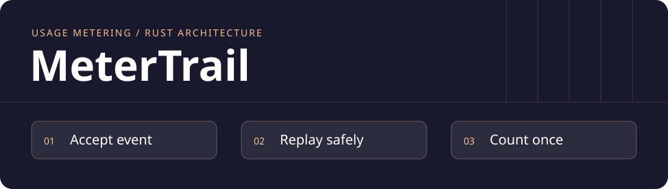
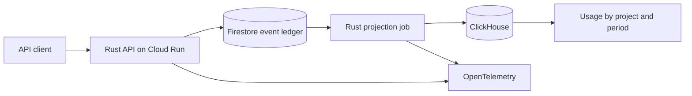

# MeterTrail

**English** · [Português](README.pt-BR.md) · **Status · runnable Rust API and cloud architecture plan**

[](https://github.com/acamilateixeira/metertrail/actions/workflows/ci.yml)

**Count API usage once, even when clients retry and workers recover.**

A usage dashboard must tell operators how many calls a project made and how fresh that number is. A client can resend after a timeout. A worker can fail after writing analytics and before recording progress. MeterTrail is designed around those two failure paths.

## Proposed architecture



| Decision | Why |
| --- | --- |
| **Rust, Axum and Tokio** | Build a typed ingestion API with explicit validation and a separate batch job. An API key resolves to its project on the server. |
| **Firestore** | A durable event identity belongs to a project. The same ID and canonical content return the prior result. Reusing the ID with different content returns a conflict. |
| **ClickHouse** | Batch projection supports time-window queries. A crash can leave duplicate physical rows. The query counts distinct event IDs within the project using the original timestamp. |
| **GCP Cloud Run, OpenTelemetry, GitHub Actions, Terraform** | Run the API and the job as managed workloads, trace both paths, run checks in CI, and reproduce the deployed resources. |

The API acknowledges durable receipt. Analytics catch up asynchronously. The demo will show pending event age and query latency so operators can tell whether the displayed total is current.

[Firestore transactions](https://docs.cloud.google.com/firestore/native/docs/manage-data/transactions) · [ClickHouse Rust client](https://clickhouse.com/docs/integrations/language-clients/rust/index) · [Cloud Run](https://docs.cloud.google.com/run/docs/overview/what-is-cloud-run) · [OpenTelemetry for Rust](https://opentelemetry.io/docs/languages/rust/)

## Cloud demo to build

1. Send the same event concurrently and confirm it contributes one unit of usage.
2. Stop the projector after the ClickHouse write and before the Firestore acknowledgement. Restart it and verify the usage total holds after replay.
3. Use the same event ID in a second project and verify isolation. Inspect the trace and watch the backlog recover.

The demo uses synthetic data. The benchmark will document the environment, load, p95 ingestion and query latency, and the cost of exact distinct counting.

## Delivery

| Milestone | Status | Evidence |
| --- | --- | --- |
| **Ingestion contract** | **Done** | Rust API, tests for concurrent retries, conflicting payloads, invalid input, and project boundaries, plus a scripted demo that runs in CI. |
| **Failure and recovery** | Next | Batch projection, an injected failure, consistent totals, and a replay test. |
| **Hosted demo** | Planned | Deployable infrastructure, a smoke test, traces, and a public walkthrough with synthetic traffic. |

## Quickstart

You need stable Rust and Cargo. The local API keeps events in memory, so every restart starts from zero.

```bash
git clone https://github.com/acamilateixeira/metertrail.git
cd metertrail
cargo test --locked   # contract tests, including 16 concurrent retries
cargo run --locked    # http://127.0.0.1:4100 (override with METERTRAIL_ADDR)
```

Two demo keys map to two projects: `demo-alpha` and `demo-beta`. Send an event, then send it again:

```bash
curl -i http://127.0.0.1:4100/v1/events \
  -H 'X-API-Key: demo-alpha' -H 'Content-Type: application/json' \
  -d '{"event_id":"evt-1","operation":"GET /orders"}'
# 201 {"event_id":"evt-1","result":"accepted"}, then 200 {"event_id":"evt-1","result":"duplicate"} on retry

curl http://127.0.0.1:4100/v1/usage -H 'X-API-Key: demo-alpha'
# {"count":1,"project":"alpha"}
```

### API contract

| Request | Result |
| --- | --- |
| New `event_id` for the project | `201` `accepted`, usage + 1 |
| Same `event_id` and same `operation` | `200` `duplicate`, usage unchanged |
| Same `event_id`, different `operation` | `409` `event_payload_conflict`, usage unchanged |
| Missing or unknown `X-API-Key` | `401` `invalid_key` |
| Blank or longer than 100 characters | `400` `invalid_event` |
| Unknown JSON fields | `422` |

## Demo

With the API running, `./scripts/demo.sh` checks the three guarantees against the real server. CI runs the same script on every change (`START_SERVER=1 ./scripts/demo.sh`).

```text
1. The same event sent 8 times at once counts once
  ✓ one request created the event
  ✓ seven requests were reported as duplicates
  ✓ usage for alpha went up by exactly 1
2. Reusing the id with different content is a conflict
  ✓ HTTP 409
  ✓ usage for alpha is unchanged
3. Projects are isolated
  ✓ the same id is new for beta (HTTP 201)
  ✓ usage for beta went up by exactly 1
  ✓ usage for alpha is unchanged
All 8 checks passed.
```

To explore by hand, import [`insomnia/metertrail.json`](insomnia/metertrail.json) into Insomnia or [`docs/postman.collection.json`](docs/postman.collection.json) into Postman. Both walk through the same steps.

## Scope of this version

Events live in memory and API keys are fixed demo values. That is enough to prove the ingestion contract, not to run in production. Firestore, ClickHouse, replay after a worker failure, and the cloud deployment are the next milestones.

## License

[MIT](LICENSE)
