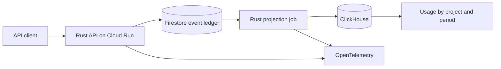

# MeterTrail

**English** · [Português](README.pt-BR.md) · **Status · runnable Rust API and cloud architecture plan**

[](https://github.com/acamilateixeira/metertrail/actions/workflows/ci.yml)

**Count API usage once, even when clients retry and workers recover.**

A usage dashboard must tell operators how many calls a project made and how fresh that number is. A client can resend after a timeout. A worker can fail after writing analytics and before recording progress. MeterTrail is designed around those two failure paths.

## Proposed architecture



| Decision | Why |
| --- | --- |
| **Rust, Axum and Tokio** | Build a typed ingestion API with explicit validation and a separate batch job. An API key resolves to its project on the server. |
| **Firestore** | A durable event identity belongs to a project. The same ID and canonical content return the prior result. Reusing the ID with different content returns a conflict. |
| **ClickHouse** | Batch projection supports time-window queries. A crash can leave duplicate physical rows. The query counts distinct event IDs within the project using the original timestamp. |
| **GCP Cloud Run, OpenTelemetry, GitHub Actions, Terraform** | Run the API and the job as managed workloads, trace both paths, run checks in CI, and reproduce the deployed resources. |

The API acknowledges durable receipt. Analytics catch up asynchronously. The demo will show pending event age and query latency so operators can tell whether the displayed total is current.

[Firestore transactions](https://docs.cloud.google.com/firestore/native/docs/manage-data/transactions) · [ClickHouse Rust client](https://clickhouse.com/docs/integrations/language-clients/rust/index) · [Cloud Run](https://docs.cloud.google.com/run/docs/overview/what-is-cloud-run) · [OpenTelemetry for Rust](https://opentelemetry.io/docs/languages/rust/)

## The demo to build

1. Send the same event concurrently and confirm it contributes one unit of usage.
2. Stop the projector after the ClickHouse write and before the Firestore acknowledgement. Restart it and verify the usage total holds after replay.
3. Use the same event ID in a second project and verify isolation. Inspect the trace and watch the backlog recover.

The demo uses synthetic data. The benchmark will document the environment, load, p95 ingestion and query latency, and the cost of exact distinct counting.

## Delivery

| Milestone | Evidence |
| --- | --- |
| **Ingestion contract** | Rust API, repeatable setup, tests for retries, conflicting payloads, and project boundaries. |
| **Failure and recovery** | Batch projection, an injected failure, consistent totals, and a replay test. |
| **Hosted demo** | Deployable infrastructure, a smoke test, traces, and a public walkthrough with synthetic traffic. |

## Run the Rust API locally

Use stable Rust and Cargo. The local API keeps events in memory and binds to `127.0.0.1:4100`.

```bash
cargo test --locked
cargo run --locked
```

Import the [Postman collection](docs/postman.collection.json) into Postman or Insomnia. It checks ingestion, retry, payload conflicts, usage, and invalid keys. The Rust test fires 16 concurrent requests and verifies that one creates an event, repeated requests keep the total at one, and another project has its own count. Firestore, ClickHouse, replay after a worker failure, and cloud deployment remain the next milestones.
