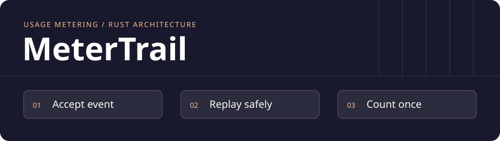
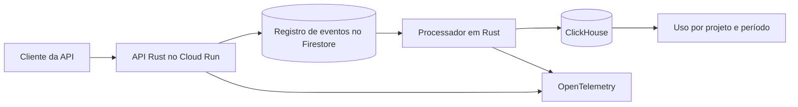

# MeterTrail

[English](README.md) · **Português** · **Status · arquitetura e plano de implementação**

**Cada chamada de API conta uma vez, mesmo com reenvios e falhas de processamento.**

Quem opera uma API precisa saber quantas chamadas um projeto fez e há quanto tempo esse número foi atualizado. Um cliente pode reenviar um evento depois de um timeout. O processador pode cair depois de gravar os dados analíticos e antes de registrar o progresso. O MeterTrail parte dessas duas falhas.

## Arquitetura proposta

| Decisão | Motivo |
| --- | --- |
| **Rust, Axum e Tokio** | Criar uma API com tipos e validação explícita, mais um job separado para os lotes. A chave da API identifica o projeto no servidor. |
| **Firestore** | Registrar a identidade durável do evento por projeto. O mesmo ID com conteúdo canônico igual devolve o resultado anterior. Conteúdo divergente gera conflito. |
| **ClickHouse** | Projetar os dados em lotes para consultar por período. Uma falha pode duplicar linhas físicas. A consulta conta IDs distintos no projeto usando a data original do evento. |
| **GCP Cloud Run, OpenTelemetry, GitHub Actions e Terraform** | Operar API e job como serviços gerenciados, rastrear os dois fluxos, rodar verificações no CI e reproduzir os recursos implantados. |

A API confirma que o evento foi persistido. Os dados analíticos são atualizados depois. A demo vai mostrar há quanto tempo o evento mais antigo está pendente e a latência das consultas, para indicar se o total exibido está atualizado.

[Transações do Firestore](https://docs.cloud.google.com/firestore/native/docs/manage-data/transactions) · [Cliente Rust do ClickHouse](https://clickhouse.com/docs/integrations/language-clients/rust/index) · [Cloud Run](https://docs.cloud.google.com/run/docs/overview/what-is-cloud-run) · [OpenTelemetry para Rust](https://opentelemetry.io/docs/languages/rust/)

## A demo que vamos construir

1. Enviar o mesmo evento em paralelo e confirmar que ele conta uma única vez.
2. Derrubar o processador após a escrita no ClickHouse e antes da confirmação no Firestore. Retomar e comprovar que o total fica correto após o reprocessamento.
3. Repetir o ID em outro projeto e verificar o isolamento. Abrir o trace e acompanhar a recuperação das pendências.

A demo usa dados sintéticos. O ensaio vai registrar ambiente, carga, p95 de ingestão e consulta e o custo da contagem exata.

## Entrega

| Marco | Evidência |
| --- | --- |
| **Contrato de ingestão** | API em Rust, ambiente reproduzível e testes de reenvio, conflito e isolamento. |
| **Falha e recuperação** | Projeção em lote, falha controlada, totais consistentes e teste de reprocessamento. |
| **Demo hospedada** | Infraestrutura reproduzível, verificação após deploy, traces e roteiro público com tráfego sintético. |

Hoje o repositório contém a arquitetura e os critérios de aceitação. Os comandos, resultados dos testes e links de deploy entram nos marcos funcionais.
