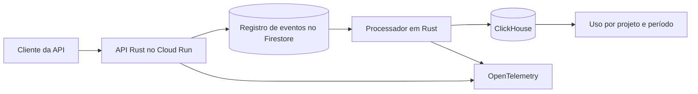

# MeterTrail

[English](README.md) · **Português** · **Status · API Rust executável e arquitetura de nuvem proposta**

[](https://github.com/acamilateixeira/metertrail/actions/workflows/ci.yml)

**Cada chamada de API conta uma vez, mesmo com reenvios e falhas de processamento.**

Quem opera uma API precisa saber quantas chamadas um projeto fez e há quanto tempo esse número foi atualizado. Um cliente pode reenviar um evento depois de um timeout. O processador pode cair depois de gravar os dados analíticos e antes de registrar o progresso. O MeterTrail parte dessas duas falhas.

## Arquitetura proposta



| Decisão | Motivo |
| --- | --- |
| **Rust, Axum e Tokio** | Criar uma API com tipos e validação explícita, mais um job separado para os lotes. A chave da API identifica o projeto no servidor. |
| **Firestore** | Registrar a identidade durável do evento por projeto. O mesmo ID com conteúdo canônico igual devolve o resultado anterior. Conteúdo divergente gera conflito. |
| **ClickHouse** | Projetar os dados em lotes para consultar por período. Uma falha pode duplicar linhas físicas. A consulta conta IDs distintos no projeto usando a data original do evento. |
| **GCP Cloud Run, OpenTelemetry, GitHub Actions e Terraform** | Operar API e job como serviços gerenciados, rastrear os dois fluxos, rodar verificações no CI e reproduzir os recursos implantados. |

A API confirma que o evento foi persistido. Os dados analíticos são atualizados depois. A demo vai mostrar há quanto tempo o evento mais antigo está pendente e a latência das consultas, para indicar se o total exibido está atualizado.

[Transações do Firestore](https://docs.cloud.google.com/firestore/native/docs/manage-data/transactions) · [Cliente Rust do ClickHouse](https://clickhouse.com/docs/integrations/language-clients/rust/index) · [Cloud Run](https://docs.cloud.google.com/run/docs/overview/what-is-cloud-run) · [OpenTelemetry para Rust](https://opentelemetry.io/docs/languages/rust/)

## A demo em nuvem que vamos construir

1. Enviar o mesmo evento em paralelo e confirmar que ele conta uma única vez.
2. Derrubar o processador após a escrita no ClickHouse e antes da confirmação no Firestore. Retomar e comprovar que o total fica correto após o reprocessamento.
3. Repetir o ID em outro projeto e verificar o isolamento. Abrir o trace e acompanhar a recuperação das pendências.

A demo usa dados sintéticos. O ensaio vai registrar ambiente, carga, p95 de ingestão e consulta e o custo da contagem exata.

## Entrega

| Marco | Situação | Evidência |
| --- | --- | --- |
| **Contrato de ingestão** | **Pronto** | API em Rust, testes de reenvio concorrente, conflito de conteúdo, entrada inválida e isolamento, e uma demo em script que roda no CI. |
| **Falha e recuperação** | Próximo | Projeção em lote, falha controlada, totais consistentes e teste de reprocessamento. |
| **Demo hospedada** | Planejado | Infraestrutura reproduzível, verificação após deploy, traces e roteiro público com tráfego sintético. |

## Início rápido

Use Rust estável e Cargo. A API local guarda os eventos em memória, então cada reinício começa do zero.

```bash
git clone https://github.com/acamilateixeira/metertrail.git
cd metertrail
cargo test --locked   # testes do contrato, incluindo 16 reenvios simultâneos
cargo run --locked    # http://127.0.0.1:4100 (troque com METERTRAIL_ADDR)
```

Duas chaves de demonstração correspondem a dois projetos: `demo-alpha` e `demo-beta`. Envie um evento e depois envie de novo:

```bash
curl -i http://127.0.0.1:4100/v1/events \
  -H 'X-API-Key: demo-alpha' -H 'Content-Type: application/json' \
  -d '{"event_id":"evt-1","operation":"GET /orders"}'
# 201 {"event_id":"evt-1","result":"accepted"} e, no reenvio, 200 {"event_id":"evt-1","result":"duplicate"}

curl http://127.0.0.1:4100/v1/usage -H 'X-API-Key: demo-alpha'
# {"count":1,"project":"alpha"}
```

### Contrato da API

| Requisição | Resultado |
| --- | --- |
| `event_id` novo no projeto | `201` `accepted`, uso + 1 |
| Mesmo `event_id` e mesma `operation` | `200` `duplicate`, uso igual |
| Mesmo `event_id`, `operation` diferente | `409` `event_payload_conflict`, uso igual |
| `X-API-Key` ausente ou desconhecida | `401` `invalid_key` |
| Campo em branco ou com mais de 100 caracteres | `400` `invalid_event` |
| Campos JSON desconhecidos | `422` |

## Demo

Com a API rodando, `./scripts/demo.sh` confere as três garantias contra o servidor real. O CI roda o mesmo script a cada mudança (`START_SERVER=1 ./scripts/demo.sh`).

```text
1. The same event sent 8 times at once counts once
  ✓ one request created the event
  ✓ seven requests were reported as duplicates
  ✓ usage for alpha went up by exactly 1
2. Reusing the id with different content is a conflict
  ✓ HTTP 409
  ✓ usage for alpha is unchanged
3. Projects are isolated
  ✓ the same id is new for beta (HTTP 201)
  ✓ usage for beta went up by exactly 1
  ✓ usage for alpha is unchanged
All 8 checks passed.
```

Para explorar à mão, importe [`insomnia/metertrail.json`](insomnia/metertrail.json) no Insomnia ou [`docs/postman.collection.json`](docs/postman.collection.json) no Postman. As duas seguem os mesmos passos.

## Escopo desta versão

Os eventos ficam em memória e as chaves são valores fixos de demonstração. Isso basta para provar o contrato de ingestão, não para produção. Firestore, ClickHouse, reprocessamento após falha do processador e deploy em nuvem são os próximos marcos.

## Licença

[MIT](LICENSE)
