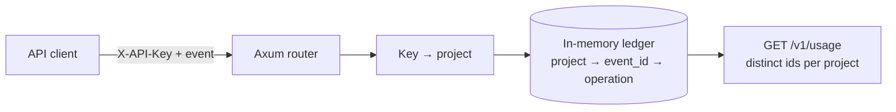
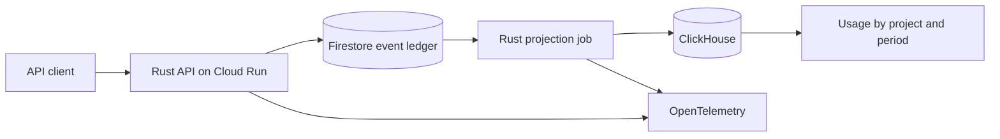

# Architecture

## Today: local ingestion contract

Everything runs in one process (`src/main.rs`):

| Part | What it does |
| --- | --- |
| Router | `POST /v1/events`, `GET /v1/usage`, `GET /health` |
| Key lookup | Maps `demo-alpha` and `demo-beta` to the `alpha` and `beta` projects |
| Validation | Rejects unknown fields, blank values, and values over 100 characters |
| Ledger | A map of project → (event id → operation) behind one mutex. Check and insert happen under the same lock. |
| Usage | Counts the ids stored for the project |

This is enough to prove the contract and its concurrency behavior. It is not durable: a restart loses every event.

## Planned: cloud pipeline

| Component | Role | Failure it handles |
| --- | --- | --- |
| Firestore ledger | Durable identity of each event per project, written in a transaction | Client retries and concurrent duplicates |
| Projection job | Moves accepted events to ClickHouse in batches and records progress | Crash between the ClickHouse write and the progress record |
| ClickHouse | Time-window queries over usage | Duplicate physical rows after a replay: queries count distinct ids |
| OpenTelemetry | Traces for ingestion and projection | Finding where a slow or failed event went |
| Terraform | Reproducible cloud resources | Drift between environments |

### Freshness

The API confirms durable receipt; analytics catch up asynchronously. The hosted demo will show the age of the oldest pending event and query latency, so an operator can tell whether the total on screen is current.

### Why the job can replay safely

The job may write a batch to ClickHouse and crash before recording its progress. On restart it writes the batch again. The duplicate rows carry the same event ids, and usage counts distinct ids per project, so the total does not change. See [Design Decisions](Design-Decisions).
