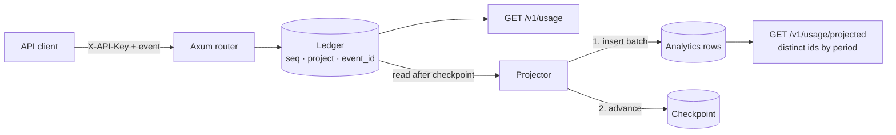
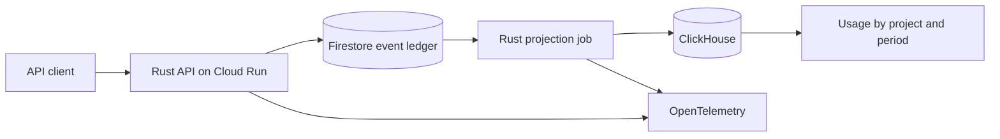

# Architecture

## Today: ingestion and projection in one process

| Part | Where | What it does |
| --- | --- | --- |
| Router | `src/main.rs` | HTTP endpoints, key lookup, validation, admin endpoints for the projection |
| Ledger | `src/ledger.rs` | `EventLedger` trait. Checks the id and inserts in one atomic step, and gives each accepted event a global sequence number. The in-memory implementation keeps one lock. |
| Projector | `src/projection.rs` | Reads events after the checkpoint, inserts them into analytics, then advances the checkpoint. One batch at a time. Supports an injected crash between the two writes. |
| Analytics | `src/projection.rs` | `Analytics` trait. Accepts duplicate rows and answers with distinct event ids per project and period. |
| Checkpoint | `src/projection.rs` | `Checkpoint` trait. Only moves forward, except on an explicit replay. |

`src/ledger.rs` and `src/projection.rs` use only the standard library. The recovery rules are tested without HTTP and without external services, and the Firestore and ClickHouse implementations will plug into the same traits.

Nothing is durable yet: a restart loses the ledger, the analytics rows, and the checkpoint.

## Planned: cloud pipeline

| Component | Role | Failure it handles |
| --- | --- | --- |
| Firestore ledger | Durable identity of each event per project, written in a transaction | Client retries and concurrent duplicates |
| Projection job | Moves accepted events to ClickHouse in batches and records progress | Crash between the ClickHouse write and the progress record |
| ClickHouse | Time-window queries over usage | Duplicate physical rows after a replay: queries count distinct ids |
| OpenTelemetry | Traces for ingestion and projection | Finding where a slow or failed event went |
| Terraform | Reproducible cloud resources | Drift between environments |

### Freshness

The API confirms receipt; analytics catch up asynchronously. `GET /v1/usage/projected` already returns the ledger head, the checkpoint, the number of pending events, and the age of the oldest one, so a client can tell whether the total is current. The hosted demo will chart the same numbers along with query latency.

### Why the job can replay safely

The job may write a batch to ClickHouse and crash before recording its progress. On restart it writes the batch again. The duplicate rows carry the same event ids, and usage counts distinct ids per project, so the total does not change. See [Design Decisions](Design-Decisions).
